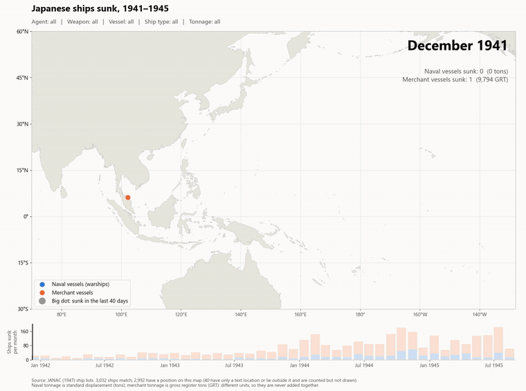
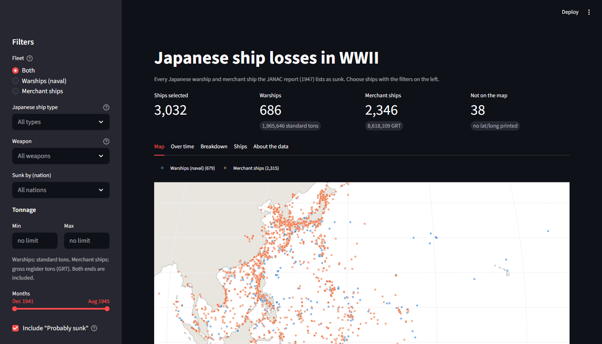
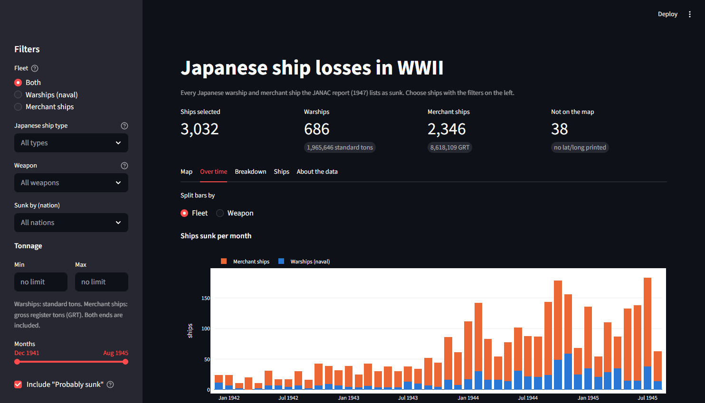
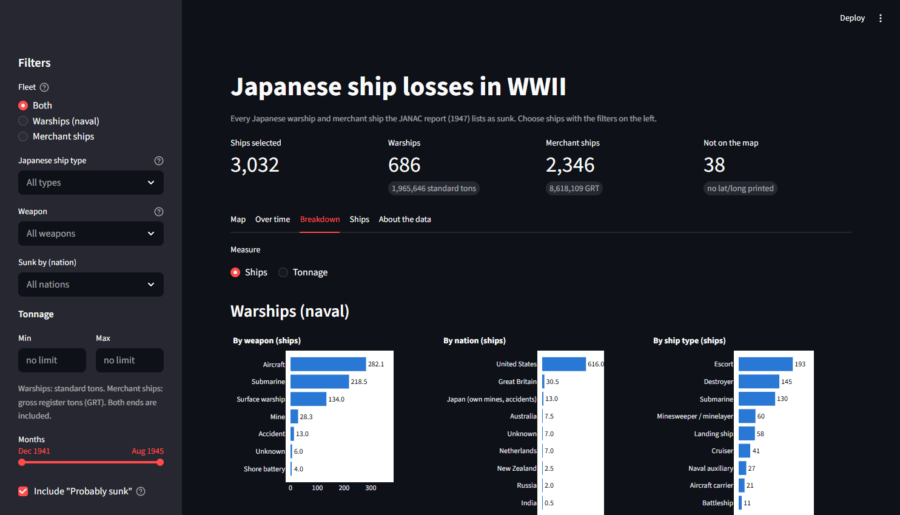
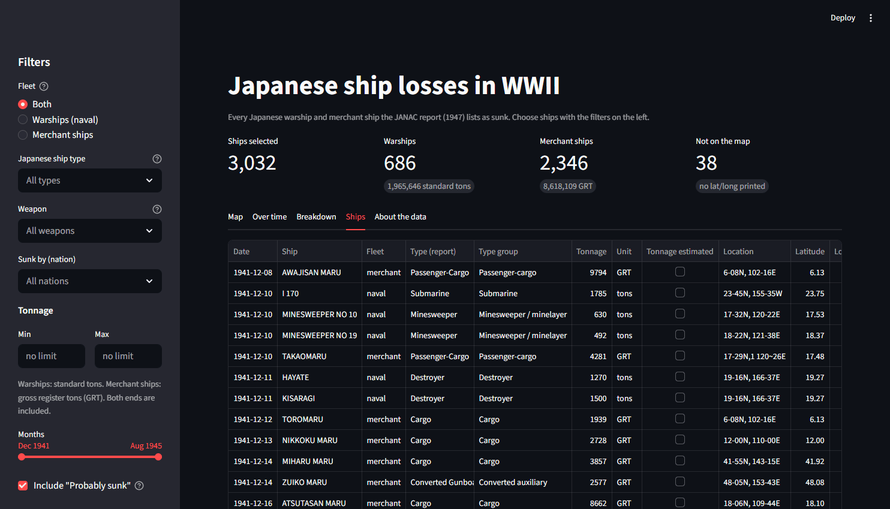

# The Fall of the Imperial Japanese Navy: WWII ship losses in data

A data science project that tells the story of how Japan's navy and merchant
fleet were destroyed in the Second World War, using maps, animations, charts
and statistical tests.

> Built with [Claude Code](https://claude.com/claude-code). See
> [How this project was made](#how-this-project-was-made).



All the data comes from one source: the **JANAC report**, *Japanese Naval and
Merchant Shipping Losses During World War II by All Causes* (Joint Army-Navy
Assessment Committee, February 1947, NAVEXOS P-468). The report is a 115-page
scanned typescript. This project reads it with OCR, checks every number against
the report's own totals, and turns it into clean CSV files.

> **The source report is not in this repository** (the scan is 29 MB). It is a
> US government publication and in the public domain. Read it online at
> [HyperWar: *Japanese Naval and Merchant Shipping Losses*](https://www.ibiblio.org/hyperwar/Japan/IJN/JANAC-Losses/index.html).
> You only need the scanned PDF (saved as `JANAC.pdf` in the project folder)
> to re-run the extraction. The cleaned CSVs are already in `data/`.

| | Ships | Tonnage |
|---|---:|---:|
| Naval vessels (warships) | 686 | 1,965,646 tons (standard displacement) |
| Merchant vessels | 2,346 | 8,618,109 GRT (gross register tons) |

Both totals match Table I of the report exactly.

> **Tonnage warning.** Warships are measured in *standard displacement* (their
> weight) and merchant ships in *gross register tons* (their internal volume).
> These are different units, so this project never adds them together.

**Start here for the results:** [`analysis_findings.md`](analysis_findings.md)
summarises what all the charts, maps, animations and tests show, with links to
the detailed explainer documents. For how the code, data pipeline and
statistical methods fit together, read [`project_guide.md`](project_guide.md).

---

## Contents

1. [Quick start](#quick-start)
2. [The data](#the-data)
3. [Analysis scripts](#analysis-scripts)
   - [Summary-table charts](#summary-table-charts)
   - [Sinking map](#sinking-map)
   - [Sinking animation](#sinking-animation)
   - [Monthly line graphs](#monthly-line-graphs)
   - [Clusters and hot spots](#clusters-and-hot-spots)
   - [US time-series analysis](#us-time-series-analysis)
   - [Where, what and how suddenly (A1, B1, B2, C1, C2)](#where-what-and-how-suddenly-a1-b1-b2-c1-c2)
   - [Shipping routes and the tanker war (R, T)](#shipping-routes-and-the-tanker-war-r-t)
   - [Interactive explorer (Streamlit app)](#interactive-explorer-streamlit-app)
4. [Filters (shared by the map, animation and cluster scripts)](#filters)
5. [Extraction pipeline (PDF to CSV)](#extraction-pipeline)
6. [Folder layout](#folder-layout)
7. [Known data issues](#known-data-issues)
8. [How this project was made](#how-this-project-was-made)

---

## Quick start

The project was built with Python 3.12 on Windows (PowerShell), but the
scripts are plain Python and also run on macOS and Linux.

```powershell
python -m venv .venv
.venv\Scripts\Activate.ps1           # macOS/Linux: source .venv/bin/activate
python -m pip install -r requirements.txt


python sinking_map.py                 # map of every sinking
python sinking_animation.py           # 60-second video of the war
python loss_line_graph.py             # losses per month
python sinking_clusters.py            # clusters + Gi* hot spots
python us_loss_time_series.py         # trend / change points / season (US only)
python -m streamlit run janac_explorer_app.py   # interactive explorer in the browser
```

The cleaned CSVs are already in `data/`, so you don't need to re-run the
extraction to use the analysis scripts.

**Packages used** (exact versions in `requirements.txt`): pandas, numpy,
matplotlib, geopandas, shapely, pyproj, scikit-learn, esda, libpysal,
statsmodels, scipy, ruptures, pymannkendall, scikit-posthocs, imageio-ffmpeg,
streamlit and plotly (for the app), plus pymupdf and rapidocr_onnxruntime for
the extraction only.

**Figures in the repository:** only the charts and animations that the reports
link to are included. Every other figure (for example the 131 maps from
`sinking_map.py --all-combinations`) is rebuilt by running its script.

---

## The data

### Ship lists (one row per ship sunk)

| File | What it holds |
|---|---|
| `data/naval/naval_losses_15-44.csv` | 686 warships, report pages 15–44 |
| `data/merchant/merchant_losses_45-115.csv` | 2,346 merchant ships, report pages 45–115 |

Main columns:

| Column | Meaning |
|---|---|
| `date`, `year`, `month`, `day` | When the ship was sunk (`day` is empty when the report doesn't give it) |
| `vessel_name`, `vessel_type` | Name and type as printed, e.g. `Destroyer`, `Cargo` |
| `tonnage`, `tonnage_estimated` | Tonnage, and whether the report marks it as an estimate (`8,000e`) |
| `location`, `lat`, `lon` | Printed position and decimal degrees. 38 ships have only a text location such as "off Japan" |
| `flag_of_agent`, `agent_type` | Who sank it and with what. Shared sinkings are `; `-separated, e.g. `United States; Australia` |
| `agent_probable` | The report marks the agent as only "probable" (`*`) |
| `issues`, `raw_*` | Parsing warnings, and the raw OCR text kept for checking |

### Summary tables

`data/summary/table_I.csv` … `table_V.csv` are the report's summary tables
(pages 8–12): losses by sinking agent, by nation and by weapon. They come from
hand-verified transcriptions in `tests/fixtures/` and are used as the
"answer key" to check the ship lists.

### Basemap

`data/basemap/ne_50m_land/` holds the Natural Earth 1:50m land polygons used
for every map.

---

## Analysis scripts

Every script has a detailed docstring at the top (inputs, outputs, how to run
it) and comments explaining each step. Run any script with `--help` to see its
options.

### Summary-table charts

`table_1_plots.py` … `table_5_plots.py` (shared code in `table_plot_helpers.py`)

These draw bar charts and pie/donut charts of Tables I–V: who sank Japan's
ships, by nation and by weapon, in ships and in tonnage.

```powershell
python table_1_plots.py
```

Output: `figures/table_I/` … `figures/table_V/`

### Sinking map

`sinking_map.py`: a map of where each ship was sunk, with one dot per ship
(blue = warship, orange = merchant ship).

```powershell
python sinking_map.py --agent us --weapon submarine --vessel merchant
python sinking_map.py --ship-type destroyer cruiser --min-tonnage 1500
python sinking_map.py --all-combinations     # every agent x weapon x vessel, empty maps skipped
python sinking_map.py --options              # list every valid filter value
```

Output: `figures/maps/sinkings_agent-…_weapon-…_vessel-…_type-…_tons-….png`

The map runs from 70°E to 128°W, so the Pacific is in one piece. Two
submarines sunk in the Atlantic (RO 501, I 52) fall outside it, and the
footnote says so.

### Sinking animation

`sinking_animation.py`: the war in one minute. Each ship appears as a bright
dot on the day it was sunk, then fades into a small dot that stays. A monthly
bar chart under the map shows where in the war you are.

```powershell
python sinking_animation.py                          # all ships, 60 s MP4
python sinking_animation.py --ship-type tanker       # the tanker war
python sinking_animation.py --duration 30 --format gif
```

Output: `figures/animations/sinkings_….mp4` (or `.gif`). A full 60-second
video takes about 3 minutes to render.

The repository holds GIFs only, because GitHub plays a GIF inside the page
but shows an MP4 only as a download link. Matplotlib's own GIFs are 20–25 MB,
so the published ones were converted from the MP4s with ffmpeg: twice the
speed (30 s), 8 frames per second, 760 px wide, a 96-colour palette. That
brings each one to 0.5–1.6 MB:

```powershell
$ff = python -c "import imageio_ffmpeg; print(imageio_ffmpeg.get_ffmpeg_exe())"
& $ff -i figures\animations\<name>.mp4 -vf "setpts=0.5*PTS,fps=8,scale=760:-1:flags=lanczos,split[a][b];[a]palettegen=max_colors=96:stats_mode=diff[p];[b][p]paletteuse=dither=bayer:bayer_scale=4:diff_mode=rectangle" figures\animations\<name>.gif
```

### Monthly line graphs

`loss_line_graph.py`: ships or tonnage lost per month, one line per fleet,
with the peak month labelled. Unlike the maps, it also counts ships without a
position.

```powershell
python loss_line_graph.py --measure tonnage --agent us --weapon submarine
```

Output: `figures/line_graphs/losses_{ships|tonnage}_….png`

This script has the agent / weapon / vessel filters, but not yet ship type or
tonnage.

### Clusters and hot spots

`sinking_clusters.py`: finds the areas where many ships were sunk and tests
them statistically.

1. **HDBSCAN** groups sinkings that lie close together, using great-circle
   distance. You choose the smallest group that counts as a cluster with
   `--min-cluster-size`.
2. **Getis-Ord Gi\*** counts sinkings in 100 km equal-area hexagons and finds
   statistically significant hot spots, using 9,999 permutations and a
   Benjamini–Hochberg false-discovery-rate correction.
3. A cluster is **confirmed** when at least half of its ships lie in
   hot-spot hexagons.

```powershell
python sinking_clusters.py                                  # all ships, min size 15
python sinking_clusters.py --min-cluster-size 30
python sinking_clusters.py --agent us --weapon submarine --min-cluster-size 10 --permutations 999
```

Output:
- `figures/clusters/clusters_….png`: a map of the clusters, coloured by whether Gi\* confirms them
- `figures/clusters/hotspots_….png`: a map of the hot-spot hexagons
- `data/clusters/clusters_….csv`: one row per cluster (place, ships, tonnage, dates, main agent and weapon, confirmed or not)

A run with the default settings takes about 2 minutes.

> A hot spot means "many ships were sunk here", not "this sea was more
> dangerous per ship". Ships were sunk where ships sailed, and the report has no
> traffic data.

### US time-series analysis

A full explanation of the methods, tests and results is in
[`us_time_series_explained.md`](us_time_series_explained.md).

`us_loss_time_series.py`: month-by-month analysis of the losses inflicted by
the United States, December 1941 – August 1945. Only the US is included
because only the US has enough sinkings every month for a time series (about
90% of all losses).

It covers warships and merchant ships, each as all US sinkings plus each weapon
with at least 100 ships, in both ships and tonnage. Shared sinkings count 1/n
per agent, so a ship sunk by two agents counts ½ to each.

| Question | Method |
|---|---|
| What does the trend look like? | STL trend (13-month smoothing) |
| Is there a steady rise or fall? | Mann-Kendall test (trend-free pre-whitening) with Sen's slope |
| When did the loss rate change? | Change points (ruptures, exact search, number chosen by BIC) |
| How fast did losses grow in each phase? | Segmented regression: negative binomial for ship counts, OLS on log(1 + tonnage) |
| Is there a season? | Likelihood-ratio test of a yearly sine/cosine wave added to the trend |
| Do the weapons differ? | Pooled model with a spline trend, testing for a shared trend shape and a shared season |

Partial months are allowed for: the war covers 24 days of December 1941 and 15
days of August 1945, so every month is analysed as losses per average-length
month.

```powershell
python us_loss_time_series.py
```

Output:
- `figures/time_series/us_{naval|merchant}_{ships|tonnage}.png`: monthly losses with the trend lines, change points and seasonal profile
- `figures/time_series/us_weapon_shares.png`: each weapon's share of the losses over time
- `data/time_series/us_monthly_losses.csv`: the monthly series
- `data/time_series/us_series_tests.csv`: trend and season tests for each series, with Benjamini–Hochberg q-values
- `data/time_series/us_trend_segments.csv`: % change per month in each phase, with 95% confidence intervals
- `data/time_series/us_weapon_comparison.csv`: the tests of whether the weapons differ

**Main findings**
- **Losses rose in jumps at change points, not gradually.** The main jumps:
  - Nov 1943: merchant losses rise from about 27 to about 77 ships a month.
  - Jan/Feb 1944: warship losses rise from about 5 to about 25 a month.
  - Sep 1944: aircraft losses jump.
  - Mar 1945: mine losses jump.
- **The weapons follow clearly different trend shapes:** submarines first, then aircraft, then mines.
- **No season survives the correction for multiple testing.** The near-misses (warships in October, aircraft in December) match single campaigns such as Leyte and the carrier raids of 1944–45.

> These are **raw** losses: they also depend on how many Japanese ships were
> still afloat, which the report doesn't give. The planned next step is to add
> fleet-size data and model loss *rates*.

### Where, what and how suddenly (A1, B1, B2, C1, C2)

Three scripts, explained in detail (methods, hypotheses, results) in
[`analysis_A1_B_C_explained.md`](analysis_A1_B_C_explained.md):

| Script | Analysis | Main statistics | Output |
|---|---|---|---|
| `distance_from_tokyo.py` | **A1:** how far from Tokyo ships were sunk, month by month | Quantile regression, Mann-Kendall, change points, clustered logistic regression | `figures/distance/`, `data/distance/` |
| `weapon_ship_analysis.py` | **B1:** which weapons sank which ship types; **B2:** ship size by weapon | Permutation χ², Cramér's V, adjusted residuals, correspondence analysis, log-linear test; Kruskal–Wallis, Dunn–Holm, Cliff's δ, HC3 regression | `figures/weapon_ship/`, `data/weapon_ship/` |
| `sinking_events.py` | **C1:** the biggest sinking events; **C2:** how concentrated losses were | Space-time single linkage, sensitivity runs; Gini with a within-month permutation test; geometric vs power-law event sizes (Vuong) | `figures/events/`, `data/events/` |

**Main findings**
- **The war first moved outwards, then collapsed onto Japan.** The median sinking was 4,370 km from Tokyo in late 1942, about 3,000 km through 1943–44, and 911 km from March 1945.
- **Each weapon had its own victims.** Surface ships sank submarines, mines sank coastal cargo ships, aircraft sank tankers and escorts.
- **Submarines sank the biggest merchant ships.**
- **The 20 biggest events were all US air raids or minefields.** Truk, 17 Feb 1944, is the largest.
- **Losses were packed into a few days:** 5% of the war's days held 29% of ship losses.

`distance_from_tokyo.py` takes the usual filters (`--agent`, `--weapon`, ...).

### Shipping routes and the tanker war (R, T)

Full method, tests and results: **[routes_tankers_explained.md](routes_tankers_explained.md)**.

| Script | Question | Main methods | Outputs |
|---|---|---|---|
| `shipping_routes.py` | **R:** where along Japan's sea lanes merchant ships were sunk, by what, and how that moved | 12 sea areas in 4 route groups; permutation χ² + adjusted residuals; multinomial logit on a time spline with month-cluster bootstrap bands; cluster-bootstrap loss-date comparison; logistic hand-over model with a Wald test | `figures/routes/`, `data/routes/` |
| `tanker_war.py` | **T:** when, where and by what tankers were sunk | Change points; beta-binomial segmented share model with a parametric-bootstrap sup-LR test; Mantel-Haenszel / Breslow-Day; median regression of size; aircraft-vs-submarine crossover date | `figures/tankers/`, `data/tankers/` |

```powershell
python shipping_routes.py
python tanker_war.py
```

**Main findings**
- **The submarines' hunting grounds moved:** Japan's own coast and the South Pacific (1942), the Central Pacific (1943), the Luzon Strait and Philippines (1944), the Yellow Sea and Sea of Japan (1945). Bias-corrected Cramér's V = 0.34.
- **Near Japan, mines and aircraft took over from submarines.** The odds of a submarine kill fell about 6× per year in coastal waters, and not at all on the outer perimeter.
- **Tanker losses jumped in September 1943**, from about 8,000 to 51,000 GRT a month. Tankers' share of merchant ships sunk went from 2.5% to 12.9%.
- **72% of the tankers lost were on the southern oil route.** Aircraft overtook submarines as the main tanker killer around October 1944, and the tankers sunk shrank from about 7,000 GRT to about 1,000 GRT.
- **Weaker than expected:** given the period, submarines did not hit tankers *more than other weapons did* (Mantel-Haenszel OR 1.08). Once ships sunk in the same month are not treated as independent, the evidence that the inner routes were hit later *on average* is weak.

### Submarine war map

`submarine_warfare_map.py`: maps of every Japanese ship sunk by a submarine
(1,382 ships; 96% of them by US submarines), with:
- **Hunting grounds:** the smallest sea areas holding 25%, 50% and 75% of the
  kills, from a weighted kernel density (great-circle distance, 150 km
  bandwidth).
- **Probable convoy routes:** drawn port to port and labelled as approximate,
  because JANAC records where ships sank, not their courses.
- **Labels on the 8 densest hot spots:** Luzon Strait, Tsugaru Strait, off
  Nagoya, off Nagasaki, north Formosa, Manila Bay, Cam Ranh Bay and the
  Yellow Sea.
- **A second figure with one map per year,** showing the hunting grounds
  moving.

```powershell
python submarine_warfare_map.py               # all Allied submarines
python submarine_warfare_map.py --agent us    # US submarines only
```
Outputs: `figures/submarine_war/`, plus the hot-spot table in `data/submarine_war/`.

### Interactive explorer (Streamlit app)

`janac_explorer_app.py`: a web app for exploring the losses with point-and-click
filters instead of command-line options.

```powershell
python -m streamlit run janac_explorer_app.py    # opens http://localhost:8501
```



| Over time | Breakdown | Ships |
|---|---|---|
|  |  |  |

- **Filters (sidebar):** fleet (warships / merchant / both), Japanese ship type
  (only the types of the chosen fleet are offered), weapon, nation, min and max
  tonnage, month range, and whether to include "Probably sunk" ships.
- **Headline numbers:** ships selected, warship tons and merchant GRT (never
  added together), and how many selected ships have no position.
- **Tabs:** an interactive map (zoom, hover a dot for the ship); monthly bars
  split by fleet or weapon, with a tonnage chart per fleet; breakdowns by
  weapon, nation and ship type; a sortable ship table with CSV download; and
  notes on the data.
- The filters come from `sinking_map.py`, so the app selects exactly the same
  ships as the map, animation and cluster scripts. Shared sinkings are split
  equally between their credits in the weapon and nation charts.

---

## Filters

`sinking_map.py`, `sinking_animation.py` and `sinking_clusters.py` share the
same filters. Leave a filter out and it includes all of its options. A wrong
value stops the program with a message that names the filter and lists its
valid options. Run any of them with `--options` to see the full list.

| Filter | Options |
|---|---|
| `--agent` | `us`, `britain`, `netherlands`, `australia`, `new_zealand`, `india`, `china`, `russia`, `japan`, `unknown` |
| `--weapon` | `aircraft`, `submarine`, `surface`, `mine`, `shore_battery`, `sabotage`, `accident`, `unknown` |
| `--vessel` | `naval`, `merchant` |
| `--ship-type` | Warships: `battleship`, `carrier`, `cruiser`, `destroyer`, `submarine`, `escort`, `mine_warfare`, `landing_ship`, `naval_auxiliary`. Merchant ships: `cargo`, `passenger_cargo`, `tanker`, `transport`, `converted_auxiliary`, `other_merchant` |
| `--min-tonnage`, `--max-tonnage` | A number of tons (both ends included). Each ship is compared using its own unit: standard tons or GRT |

How the filters behave:
- **Several values:** a filter can take more than one, e.g. `--agent us britain`.
- **Other spellings work:** e.g. `aeroplane`, `usa`, `uk`, `destroyers`, `oiler`.
- **`japan` as an agent** means accidents (marine casualties) and Japan's own minefields. It does *not* mean friendly fire.
- **Shared sinkings** appear under every agent and weapon involved.
- **File names** record the filters, so different selections never overwrite each other.

---

## Extraction pipeline

The report is a scanned typescript, so its text layer is unreliable. The
pipeline re-reads every page with RapidOCR at 300 dpi and rebuilds the table
rows from word positions.

```powershell
python test_extraction.py --pages 8-18                 # PASS/WARN/FAIL per page
python extract_janac.py                                # all pages -> data/raw/
python ship_lists/naval_pages.py --pages 15-44         # -> data/naval/
python ship_lists/merchant_pages.py                    # -> data/merchant/
python summary_tables/page_08_table_I.py               # ... page_12_table_V.py -> data/summary/
```

How the results are checked:
- **Monthly subtotals:** every month is checked against the subtotal printed in the report.
- **Summary-table cells:** every cell is compared with a hand-verified transcription.
- **Manual fixes:** misreads that need a person to read the scan are fixed in each script's `MANUAL_FIXES`, and every fix is flagged in the output.
- **OCR cache:** the OCR results are cached in `data/ocr_cache/`. Delete the cache if you change the OCR settings.

Section 3 of [`project_guide.md`](project_guide.md) describes the page layout
and the OCR quirks in full.

The extraction needs the scanned report saved as `JANAC.pdf` in the project
folder (see the link at the top). `data/raw/` and `data/ocr_cache/` are
created by these commands and are not in the repository.

---

## Folder layout

```
requirements.txt             package versions
analysis_findings.md         the results, with the charts
project_guide.md             how the code, data and statistics fit together
*_explained.md               full statistical detail per analysis
extract_janac.py             OCR + table parsing
test_extraction.py           per-page checks against hand-made fixtures
ship_lists/                  ship-list parsers and manual fixes
summary_tables/              Tables I-V parsers
table_*_plots.py             summary-table charts (+ table_plot_helpers.py)
sinking_map.py               map + the shared filters
sinking_animation.py         animated map
loss_line_graph.py           monthly line graphs
sinking_clusters.py          HDBSCAN + Gi* hot spots
us_loss_time_series.py       US time-series analysis
distance_from_tokyo.py       A1: distance from Tokyo over time
weapon_ship_analysis.py      B1/B2: weapon x ship type, ship size by weapon
sinking_events.py            C1/C2: sinking events, concentration of losses
shipping_routes.py           R: merchant losses by sea area and route group
tanker_war.py                T: the tanker war
submarine_warfare_map.py     submarine kills, hunting grounds, probable routes
janac_explorer_app.py        Streamlit app: interactive filters, map, charts, table
data/
  naval/, merchant/          cleaned ship lists
  summary/                   Tables I-V
  clusters/, time_series/    analysis results
  distance/, weapon_ship/, events/, routes/, tankers/, submarine_war/
  basemap/                   Natural Earth land polygons (public domain)
figures/                     charts and animations used in the reports
docs/screenshots/            screenshots of the Streamlit app
tests/fixtures/              hand-verified transcriptions
```

Not in the repository (rebuilt by the scripts, or downloaded): `JANAC.pdf`,
`data/raw/`, `data/ocr_cache/`, `data/test_run*/`, and figures the reports
don't link to.

---

## Known data issues

These are recorded in the scripts and are too small to change any result.

**Errors in the report itself**
- The August 1945 merchant subtotal says 48 ships / 99,094 t, but the page lists 49 ships / 99,969 t. Table I agrees with 49.
- Table IV's printed merchant total (492,589) is 2 more than the sum of its rows.

**Positions**
- 38 ships have no map position. Their location is given only as text, such as "off Japan".
- Two warship positions can't be read: I 182 (p21) and RO 116 (p25).

**Agents and tonnage**
- KENKOKU (p54) has only its name and tonnage printed, so its agent is "Unknown" here. The report's Table II counts it as a US sinking.
- The US merchant total is 100 GRT below Table II and the Japan-credited total 100 GRT above. Somewhere one tonnage or agent is misread in a way that leaves the monthly subtotals right. It hasn't been found yet.
- A few agent cells were misread by OCR and are fixed in `sinking_map.py` (e.g. `Lirorart` → `Aircraft`). These fixes should eventually move into the ship-list `MANUAL_FIXES`.

---

## How this project was made

This project was built with [Claude Code](https://claude.com/claude-code),
Anthropic's AI coding assistant, working in the terminal. Claude Code
wrote and ran the code:
- the OCR extraction pipeline and its checks against the report's totals;
- the charts, maps and animations;
- the statistical analyses and the Streamlit app;
- the explainer documents.

The author chose the questions to ask, steered each analysis, and checked
doubtful values against the scanned pages.

**Sources:** the JANAC report (1947) is US government work in the public
domain. The basemap is [Natural Earth](https://www.naturalearthdata.com/)
(public domain).
