# The fall of the Imperial Japanese Navy: key findings

This document pulls together what the charts, maps, animations and statistical
tests in this project show. It is the overview. The full methods, hypotheses,
equations and diagnostics are in the explainer documents:

- [`us_time_series_explained.md`](us_time_series_explained.md): trends, change points and seasonality of US sinkings
- [`analysis_A1_B_C_explained.md`](analysis_A1_B_C_explained.md): distance from Tokyo (A1), weapon × ship type (B1, B2), sinking events and concentration (C1, C2)
- [`routes_tankers_explained.md`](routes_tankers_explained.md): shipping routes (R1–R5) and the tanker war (T1–T6)

Every number below comes from the project's own CSV files (`data/`) or from
the figures they produce (`figures/`).

> **Units.** Warship tonnage is *standard displacement* (tons) and merchant
> tonnage is *gross register tons* (GRT). They measure different things, so
> they are reported side by side and never added. Where a JANAC summary
> table prints a "naval + merchant" total, it is quoted only as a share.

---

## Summary in ten points

1. **The United States sank almost everything.** It sank 92.7% of the warship tonnage and 91.8% of the merchant tonnage. All other Allies together sank about 3%, and accidents another 3%.
2. **Submarines destroyed the merchant fleet; aircraft destroyed the navy.** US submarines sank 60% of the merchant GRT that US forces sank. US Navy and Marine aircraft sank 40% of the warship tonnage, ahead of submarines at 30%.
3. **The collapse came late and suddenly.** Most losses fell in 1944: 49% of all warship tonnage and 45% of all merchant GRT. Merchant losses jumped in November 1943, from about 114,000 GRT a month to about 274,000.
4. **The weapons took over from each other in turn: submarines, then aircraft, then mines.** Submarines did most of the work until mid-1944. Carrier and land-based aircraft then took the lead. In the last five months of the war, air-dropped mines in Japan's home waters became the main killer.
5. **The noose tightened.** Until February 1945 the median sinking was about 3,000–4,400 km from Tokyo. From March 1945 it was 911 km, and 57% of sinkings were within 1,000 km of Tokyo.
6. **Losses clustered at chokepoints on the convoy routes.** They were densest in the Luzon Strait, around Formosa, the Tsugaru and Shimonoseki straits, the Korea Strait, Manila Bay and off Japan's own ports.
7. **The submarines' hunting grounds moved as the war went on.** Early on they were off Japan and Formosa. In 1943 they were the outer perimeter (Truk, Palau and the Bismarcks). In 1944 they were the southern oil route. In 1945 they were the Yellow Sea, the Sea of Japan and the Tsugaru Strait.
8. **Losses came in a few catastrophic days.** The worst 5% of war days account for 76% of all warship tonnage lost. Event sizes follow a heavy-tailed (power-law-like) distribution. The biggest events were carrier raids on crowded anchorages.
9. **Capital ships were half the naval tonnage.** 32 battleships and carriers make up 896,000 tons, which is 45.6% of all warship tonnage lost.
10. **The tanker war was a matter of geography rather than targeting.** Tankers rose from 2.5% to 12.9% of merchant ships sunk. However, a tanker was no more likely than a cargo ship on the same route to be sunk by a submarine. The tankers sunk became much smaller over time: their median size fell 60% a year.

---

## 1. Who sank the Japanese fleet

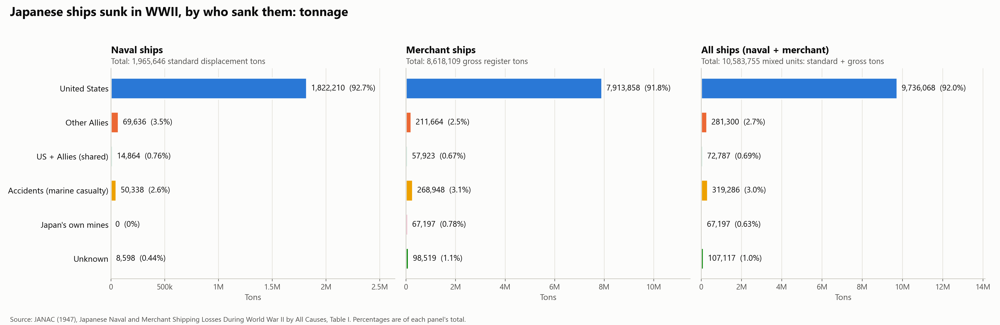

| Agent (Table I) | Warships (tons) | Share | Merchant (GRT) | Share |
|---|---:|---:|---:|---:|
| United States | 1,822,210 | 92.7% | 7,913,858 | 91.8% |
| Other Allies | 69,636 | 3.5% | 211,664 | 2.5% |
| US + Allies shared | 14,864 | 0.8% | 57,923 | 0.7% |
| Accidents (marine casualty) | 50,338 | 2.6% | 268,948 | 3.1% |
| Japan's own mines | 0 | 0% | 67,197 | 0.8% |
| Unknown | 8,598 | 0.4% | 98,519 | 1.1% |

- **The other Allies were a small, mostly submarine effort.** British, Dutch, Australian, Soviet, Chinese and New Zealand forces sank a combined 2.7% of the tonnage. Submarines account for half of it: 44% of their warship tons and 51% of their merchant GRT (Table III). The 1945 Java Sea and Malacca Strait hunting grounds (Section 7) are largely British and Dutch submarine kills.
- **Accidents cost Japan about as much as all the non-US Allies combined.** Japan's own defensive minefields sank 67,197 GRT of its own merchant ships.
- **Most credits are firm.** Only 367,555 tons in total are marked "probable" (Table V), about 3.5% of the combined tonnage.

## 2. Which weapons did the damage

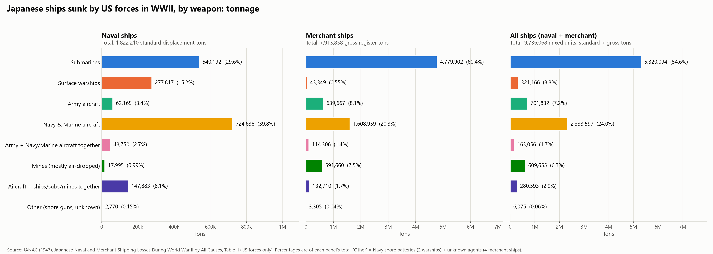

US forces only (Table II):

| Weapon | Warships (tons) | Share | Merchant (GRT) | Share |
|---|---:|---:|---:|---:|
| Submarines | 540,192 | 29.6% | 4,779,902 | 60.4% |
| Navy & Marine aircraft | 724,638 | 39.8% | 1,608,959 | 20.3% |
| Army aircraft | 62,165 | 3.4% | 639,667 | 8.1% |
| Surface warships | 277,817 | 15.2% | 43,349 | 0.5% |
| Mines | 17,995 | 1.0% | 591,660 | 7.5% |
| Joint / other | 199,403 | 10.9% | 250,321 | 3.2% |

The two fleets were destroyed by different weapons. The merchant fleet,
which supplied Japan's war economy, was mostly sunk by submarines. The
warships were mostly sunk by carrier aircraft. Surface warships sank 15% of
the naval tonnage but almost no merchant ships.

**Which ship types met which weapons** ([`weapon_by_type_naval.png`](figures/weapon_ship/weapon_by_type_naval.png), [`weapon_by_type_merchant.png`](figures/weapon_ship/weapon_by_type_merchant.png)):

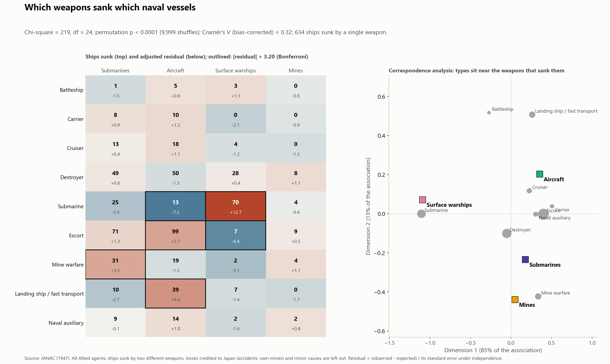

- **Warships show a clear pattern:** χ² = 219, df 24, permutation p < 0.0001, bias-corrected Cramér's V = 0.32. The pattern survives conditioning on year (log-linear test p ≈ 1e-28), so it is not just a by-product of timing.
  - *Japanese submarines were sunk by surface warships*: 70 of 112, adjusted residual +12.7. That is anti-submarine warfare by destroyer escorts, and the largest single association in the data.
  - *Escorts and landing ships / fast transports were sunk by aircraft* (+3.7 and +4.4). Escorts were rarely sunk by surface ships (−6.4).
  - *Mine-warfare vessels were sunk by submarines* (+3.5).
- **Merchant ships show only a weak pattern:** V = 0.11. A merchant ship of any type mostly met whichever weapon was active where it sailed. Within that:
  - *mines sank more cargo ships than expected* (+7.0);
  - *submarines sank more passenger-cargo ships* (+4.7);
  - *aircraft sank more tankers* (+3.8).

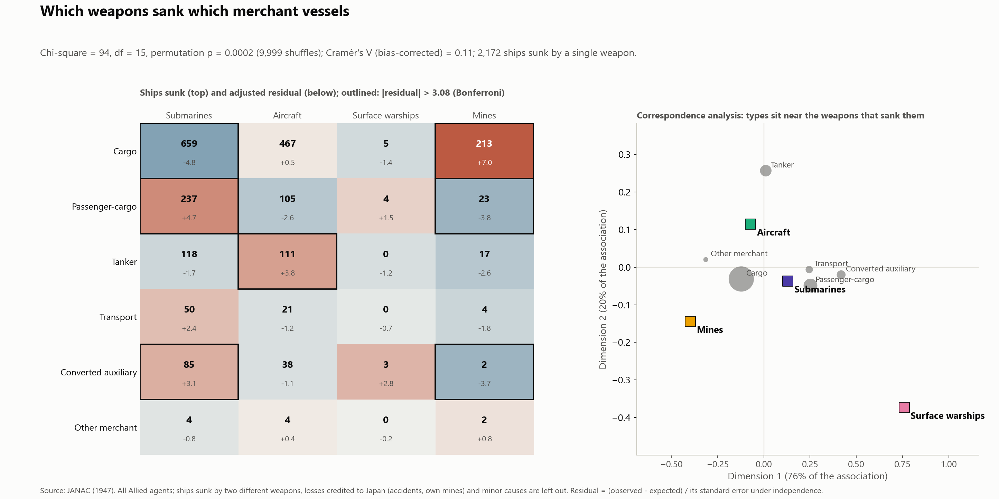
- **Submarines took the bigger merchant ships:** median 3,967 GRT, against 2,722 GRT for aircraft and 1,500 GRT for mines (Kruskal-Wallis p ≈ 7e-37). Mines sank the small coastal ships that were still moving in 1945.

## 3. When: a late and sudden collapse

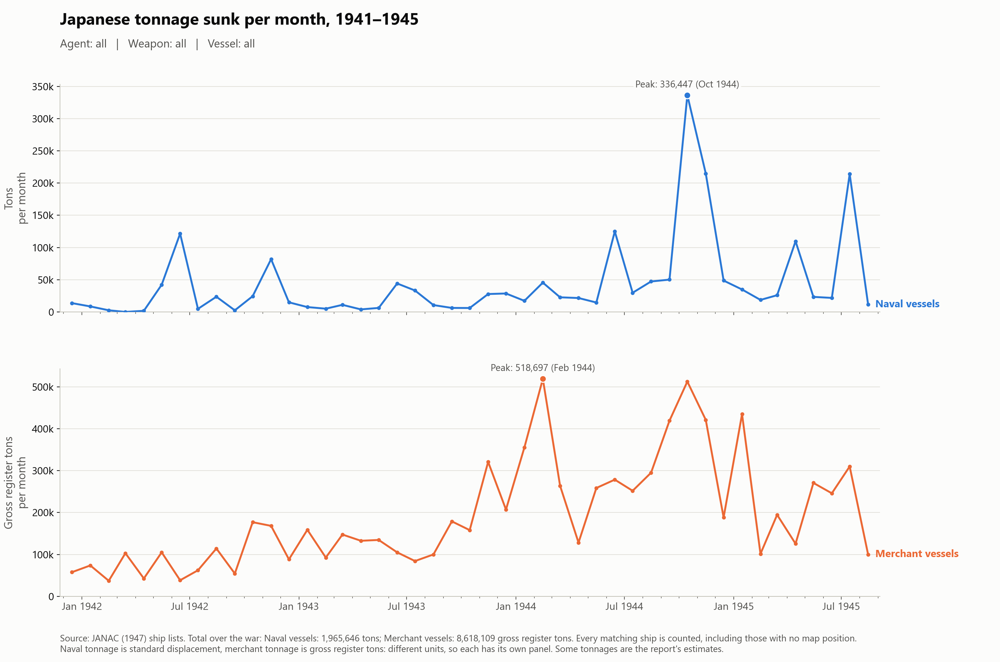

| Year | Warships | Warship tons | Merchant ships | Merchant GRT |
|---|---:|---:|---:|---:|
| 1941 (Dec) | 12 | 13,668 | 12 | 57,758 |
| 1942 | 60 | 325,253 | 229 | 1,065,398 |
| 1943 | 85 | 189,361 | 434 | 1,820,919 |
| **1944** | **322** | **969,669** | **969** | **3,891,019** |
| 1945 (to Aug) | 201 | 458,218 | 702 | 1,783,015 |

- **The naval curve is a series of battle spikes.** It rises in June 1942 (Midway, four carriers) and November 1942 (Guadalcanal). The peak is October 1944 at 336,447 tons, the Battle of Leyte Gulf. July 1945 (213,975 tons) is the carrier raids on Kure and other Japanese ports. Between the spikes, warship losses were low.
- **The merchant curve has stepped levels.** It climbs from roughly 50–100k GRT a month in 1942 to a plateau of about 250–500k GRT from late 1943. The highest month is February 1944 (518,697 GRT, including the Truk raid), with a second peak in October–November 1944.
- **Segmented regression on US merchant sinkings** ([`us_merchant_tonnage.png`](figures/time_series/us_merchant_tonnage.png)) puts the change points at August 1942 and November 1943. The phase means were 46k, 114k and 274k GRT a month.

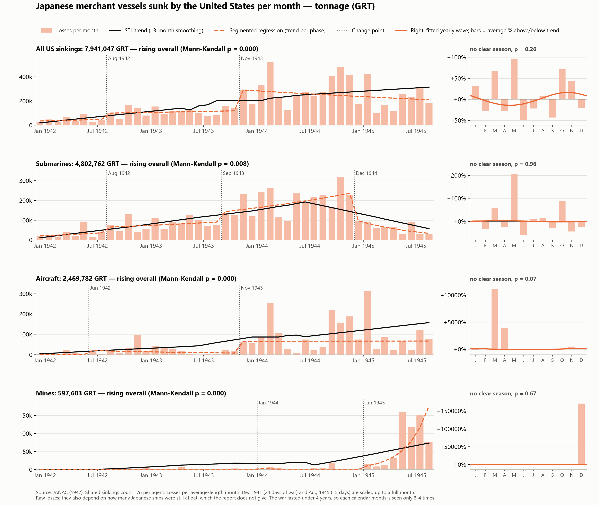

- **US submarine merchant tonnage fell in the last phase:** −12.5% a month from December 1944 (95% CI −21.6 to −2.3%, p = 0.019). This was not because the submarines got worse. The remaining Japanese ships had retreated into the Yellow Sea, the Sea of Japan and the Inland Sea, where submarines found few targets and mines and aircraft took over.
- **No seasonality.** None of the series shows a significant yearly cycle (for example all US merchant GRT p = 0.26, submarines p = 0.96). This is a null result: with under four years of data, each calendar month appears only 3–4 times, so the test has little power.

## 4. The weapon hand-over

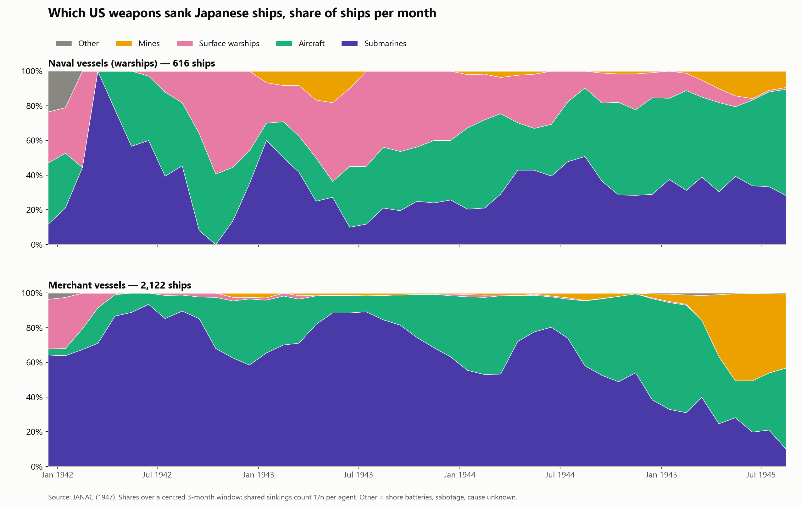

The stacked-share chart is the clearest single picture of how the campaign
changed. For US sinkings of merchant ships:

| Period | Main weapon | Approximate share of ships |
|---|---|---|
| 1942 – mid-1943 | Submarines | 60–90% |
| mid-1943 – mid-1944 | Submarines, with a growing aircraft share | submarines 55–80% |
| late 1944 – early 1945 | Aircraft (carrier raids on the Philippines, Formosa and Indochina) | aircraft 45–60% |
| Apr – Aug 1945 | Mines (B-29 minelaying, Operation Starvation) and aircraft | mines up to 50% |

- **Mines went from rare to dominant in the last months.** Before March 1945, mines sank about 0.7 merchant ships a month. From March to August 1945 they sank about 40 a month (segmented regression, `us_trend_segments.csv`).
- **The same hand-over happened on every route, at different times** ([`weapon_handover.png`](figures/routes/weapon_handover.png); test R5). The odds that a merchant loss was a submarine kill fell each year:

  | Route group | Odds ratio per year | 95% CI |
  |---|---:|---|
  | Southern resource route | 0.48 | 0.28–0.80 |
  | Inner zone (China and Korea) | 0.44 | 0.29–0.69 |
  | Japanese coastal waters | 0.17 | 0.08–0.33 |
  | Outer perimeter | 0.98 | 0.65–1.48 (no change) |

  The test of equal slopes rejects (Wald χ² = 22.6, df 3, p = 5e-5). The shift was fastest in Japan's home waters, where mines took over almost completely in 1945.

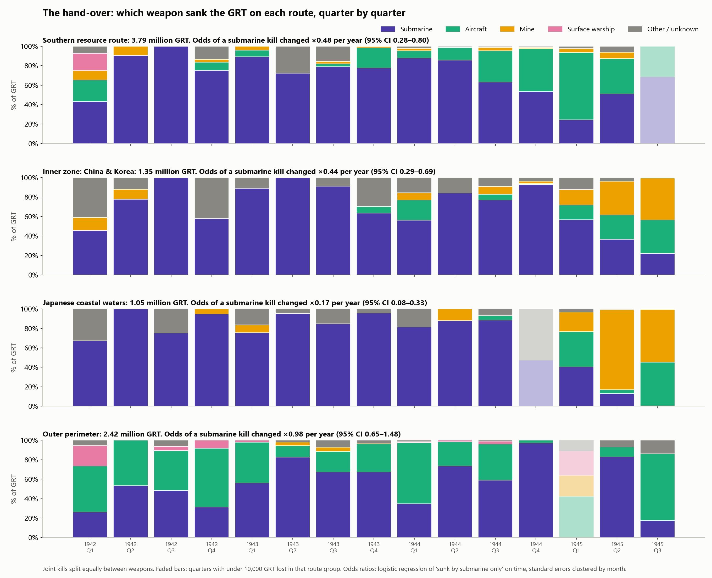

## 5. The noose tightens: distance from Tokyo

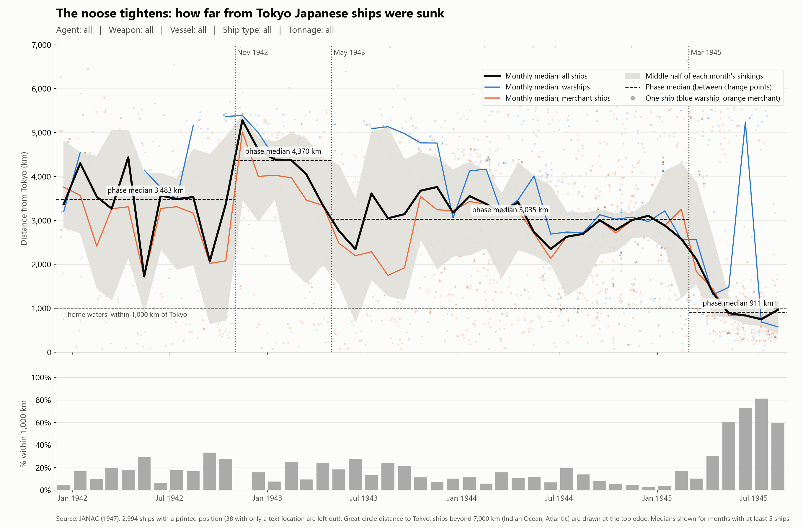

Change-point analysis on monthly median distance finds four phases:

| Phase | Months | Ships | Median distance from Tokyo | Share within 1,000 km |
|---|---|---:|---:|---:|
| 1. Expansion | Dec 1941 – Oct 1942 | 241 | 3,483 km | 19.5% |
| 2. Solomons / New Guinea | Nov 1942 – Apr 1943 | 204 | 4,370 km | 12.3% |
| 3. Attrition across the empire | May 1943 – Feb 1945 | 1,846 | 3,035 km | 10.1% |
| 4. Siege of the home islands | Mar 1945 – Aug 1945 | 703 | 911 km (CI 824–1,446) | 56.8% |

- **The distance stayed high for almost three years, then dropped sharply.** The median stayed at roughly 3,000 km throughout 1943–44, even though the front moved. This is because losses were spread along the long southern route rather than at the front line.
- **The fall came in March 1945.** After the Philippines and Iwo Jima, Japanese shipping left the open sea almost entirely. In July 1945, 81% of sinkings were within 1,000 km of Tokyo.

## 6. Where: chokepoints and hot spots

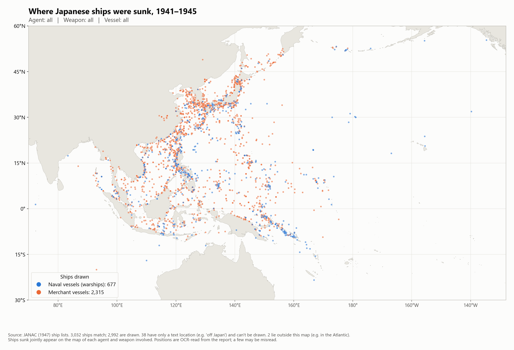

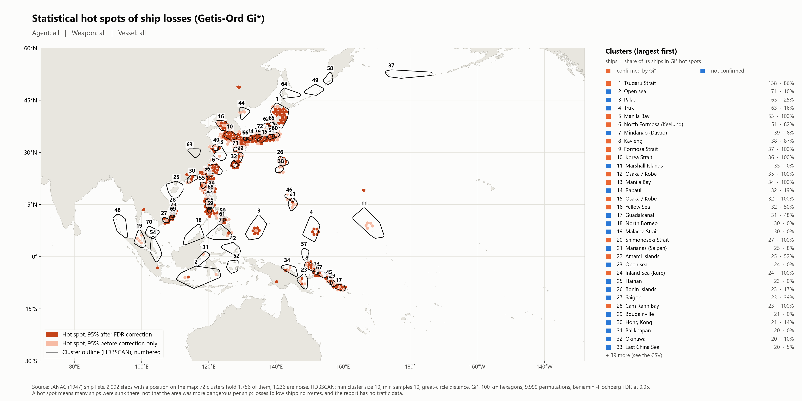

- **72 clusters (HDBSCAN) hold 1,756 of the 2,992 positioned ships.** The largest is the Tsugaru Strait (138 ships; 86% of them are in Getis-Ord Gi* hot spots that survive FDR correction).
- **The hot spots that survive correction are all chokepoints or harbours.** They are:
  - Japan: the Tsugaru, Shimonoseki and Korea straits; Osaka/Kobe and the Inland Sea (Kure);
  - Formosa and the Philippines: North Formosa (Keelung), the Formosa Strait, Manila Bay;
  - Indochina: Cam Ranh Bay;
  - the Bismarcks: Kavieng.
- **Several large clusters are not hot spots** (for example Truk, Palau, Rabaul and the Marshall Islands). These were one-off raids on an anchorage: many ships in one place on one day, but no lasting concentration of losses in the surrounding hexagons.
- **Caveat:** a hot spot is where many ships were sunk, not where a ship was most at risk. Losses follow the traffic, and JANAC gives no traffic data.

## 7. The submarine war: routes and hunting grounds

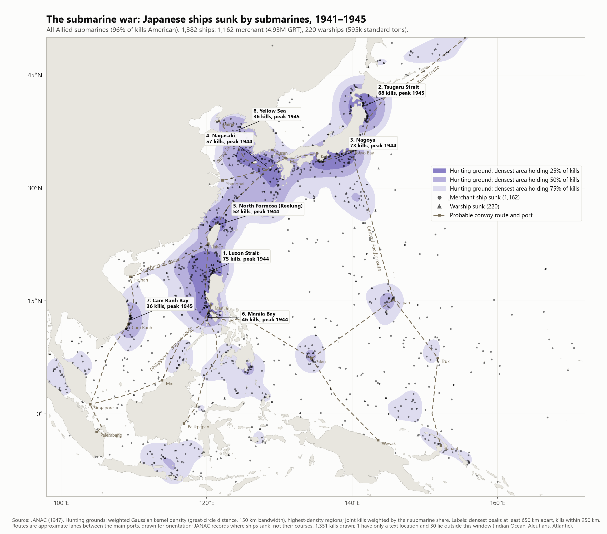

1,382 ships had at least part of their sinking credited to a submarine:

- 1,162 merchant ships, 4.93M GRT;
- 220 warships, 595k tons.

The densest hunting grounds lay along the convoy routes:

| Hot spot | Kills within 250 km | Peak year |
|---|---:|---|
| Luzon Strait | 75 | 1944 |
| Off Nagoya | 73 | 1944 |
| Tsugaru Strait | 68 | 1945 |
| Off Nagasaki | 57 | 1944 |
| North Formosa | 52.5 | 1944 |
| Manila Bay | 45.5 | 1944 |
| Cam Ranh Bay | 36 | 1945 |
| Yellow Sea | 36 | 1945 |

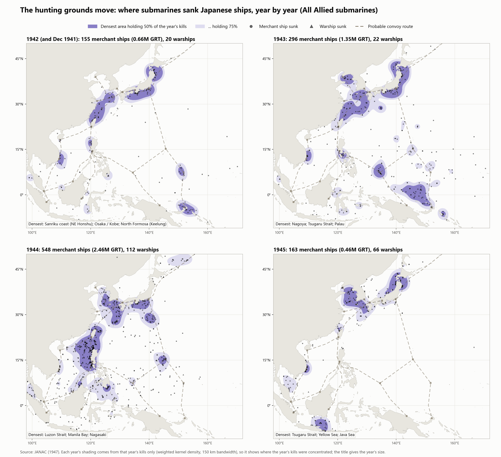

- **1942:** off Japan's own coasts (Sanriku and Osaka/Kobe) and North Formosa. Submarines sank 155 merchant ships that year.
- **1943:** the outer perimeter became the main ground: Truk–Rabaul, Palau, and the Marianas route. The outer perimeter's share of submarine kills rose to about 49% by late 1943 ([`submarine_route_shares.png`](figures/routes/submarine_route_shares.png)).
- **1944:** this was the decisive year, with 548 merchant ships sunk. The Luzon Strait ("Convoy College") and Manila were the main grounds. The southern resource route took about 70% of all submarine kills in late 1944.
- **1945:** the outer routes were empty. Submarines moved into the Yellow Sea, the Sea of Japan (via the Tsushima Strait from June 1945) and the Tsugaru Strait, where the inner zone took 74% of kills. British and Dutch boats worked the Java Sea.

The change in where submarines sank ships over time is highly significant:

- **Area × year:** χ² = 424, df 33, permutation p = 0.0001, V = 0.34.
- **Multinomial spline model:** LR χ² = 337, df 12, p ≈ 9e-65.

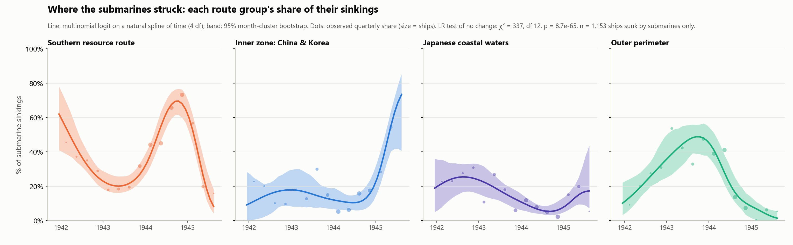

## 8. Catastrophic days: concentration and events

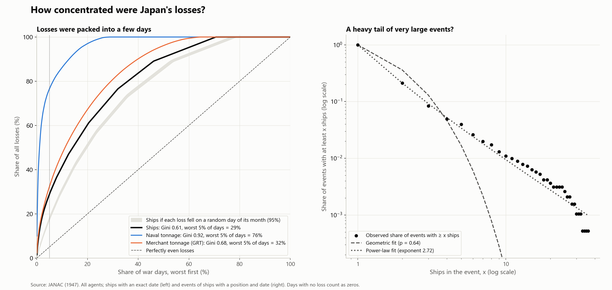

| Measure | Gini over war days | Worst 5% of days hold | Null Gini (random day within month) |
|---|---:|---:|---:|
| Ships | 0.61 | 29% | 0.51 (95%: 0.50–0.52) |
| Warship tons | 0.92 | 76% | 0.89 |
| Merchant GRT | 0.68 | 32% | 0.58 |

- **Losses bunch on single days more than chance predicts.** The bunching permutation test gives p = 0.001 for all three measures. Warship tonnage is extremely concentrated, because a few battle days sank the battleships and carriers.
- **Event sizes have a heavy tail.** An event is a set of ships sunk within 1 day and 100 km of each other. A discrete power law (exponent 2.72) fits far better than a geometric distribution (Vuong z = 5.9, p = 3e-9). 79% of events are single ships, yet half of all ships sunk went down in events of 2 or more.

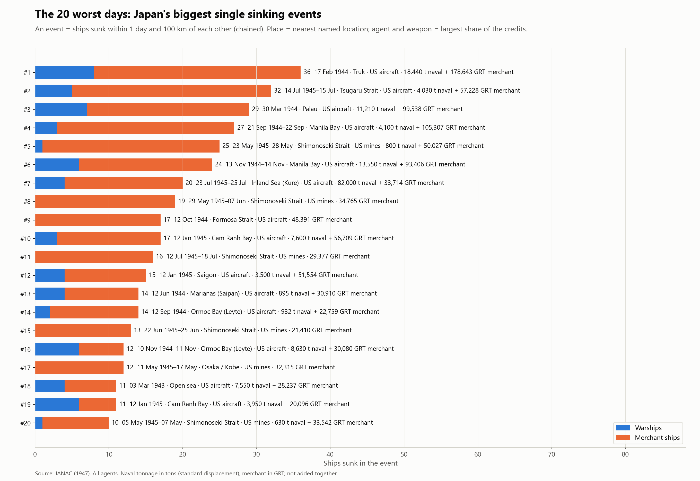

The biggest events were almost all US air raids on crowded anchorages, plus
the mine barrage of the Shimonoseki Strait:

| # | Date | Place | Agent | Ships |
|---|---|---|---|---:|
| 1 | 17 Feb 1944 | Truk (Operation Hailstone) | US carrier aircraft | 36 |
| 2 | 14–15 Jul 1945 | Tsugaru Strait | US carrier aircraft | 32 |
| 3 | 30 Mar 1944 | Palau | US carrier aircraft | 29 |
| 4 | 21–22 Sep 1944 | Manila Bay | US carrier aircraft | 27 |
| 5 | 23–28 May 1945 | Shimonoseki Strait | US mines | 25 |
| 6 | 13–14 Nov 1944 | Manila Bay | US carrier aircraft | 24 |
| 7 | 23–25 Jul 1945 | Inland Sea (Kure) | US carrier aircraft | 20 |

On 12 January 1945 the US carrier raid into the South China Sea produced
three of the top 20 events: Cam Ranh Bay twice and Saigon. It also sank 12
tankers in a single day.

## 9. Capital ships

32 battleships and carriers were sunk, totalling 896,000 tons, which is
45.6% of all warship tonnage lost. Half of them (16 ships, 451,500 tons) went
down in 1944: the Philippine Sea in June and Leyte Gulf in October. The
battleship and carrier animation
([`...battleship+carrier...gif`](figures/animations/sinkings_agent-all_weapon-all_vessel-all_type-battleship+carrier_tons-all.gif))
shows them in three groups:

- 1942: Midway, Coral Sea and the Solomons;
- 1944: the Philippine Sea, Leyte Gulf and the Formosa–Okinawa approaches;
- 1945: the ships sunk at anchor at Kure in July.

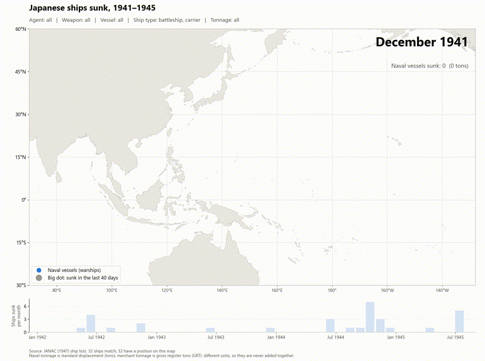

## 10. The tanker war

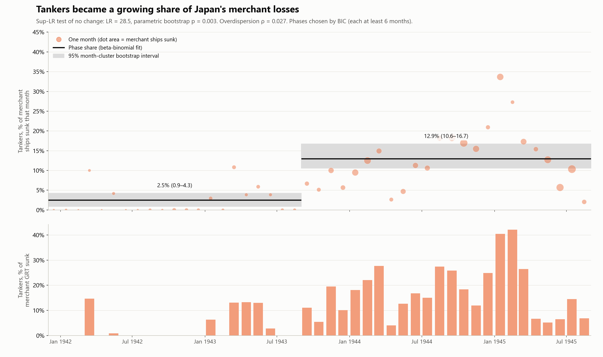

Oil was the reason for Japan's southern conquests, and the tankers carrying it
were a deliberate US priority. The data shows the following.

- **Tanker losses grew in three steps** (T1). The breaks fall at January 1943 and September 1943, and the mean tanker GRT sunk per month went from 1,234 to 8,442 to 51,120.
- **The tanker share of merchant ships sunk jumped once, in September 1943** (T2), from 2.5% (0.9–4.3%) to 12.9% (10.6–16.7%). The sup-LR test gives a parametric-bootstrap p = 0.003. Months are overdispersed (ρ = 0.027), so a beta-binomial model is used rather than a binomial.
- **Submarines did not single out tankers** (T3). Within each period, the odds that a tanker loss was a submarine kill were the same as for other merchant ships: Mantel-Haenszel OR = 1.08 (0.81–1.43), p = 0.62. The one exception is 1942–43 (OR 2.98, CI 1.02–8.71), when only a handful of tankers were sunk.
- **Geography explains the rise** (T4). 188 of the 262 tankers sunk were on the southern resource route (adjusted residual +11.4; χ² = 131, V = 0.23). Tankers were sunk because they sailed through the Luzon Strait and the South China Sea, where the submarines and aircraft were.
- **Aircraft took over tanker killing** (T6). The odds of an aircraft rather than a submarine kill rose ×5.2 a year (2.1–13.1). The crossover came on about 5 October 1944 (CI June 1944 – February 1945).
- **The tankers got smaller** (T5). Their median size fell 60% a year (−71 to −46%). Ships under 1,000 GRT made up 8% of tankers sunk in 1943, 21% in 1944 and 46% in 1945. 31 of the 103 tankers sunk in 1945 are listed at exactly 834 GRT. That is probably a small standard wartime design built to replace the large tankers already lost.

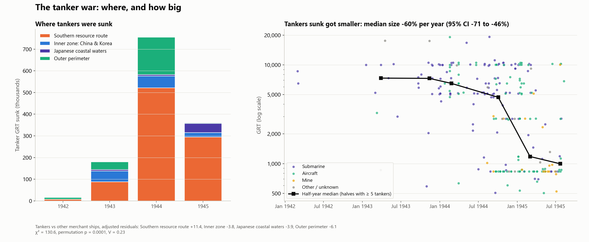

## 11. What the animations add

The animations show the same story as it happens, month by month. The GIFs
below play the war in 30 seconds. `sinking_animation.py` renders the full
60-second MP4 versions.

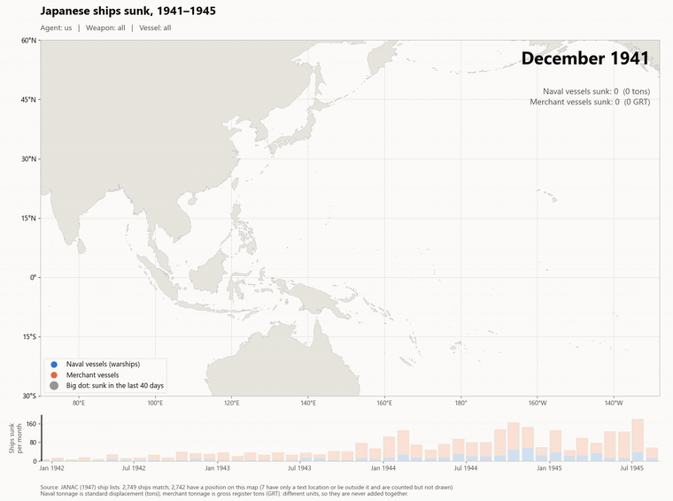

- **All US sinkings.** By September 1942 the losses are scattered: the Solomons, Japan's east coast and Formosa. By September 1943 they fill the outer perimeter. By September 1944 the South China Sea and the Luzon Strait are thick with dots. By August 1945 the newest sinkings are almost all around Korea and the home islands. The cumulative count in the corner reaches 621 warships and 2,128 merchant ships.
- **Mines.** The map is almost empty until early 1945, when the Shimonoseki Strait, the Inland Sea and Korean ports fill in within a few months. The monthly bar strip jumps from near zero to 60+ ships a month.

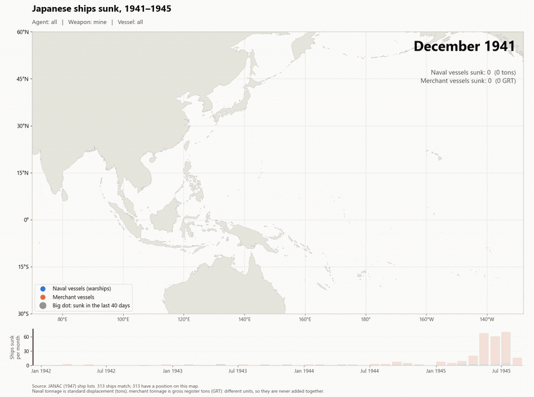

- **Submarines and aircraft** (not in the repository; build them with `python sinking_animation.py --weapon submarine` and `--weapon aircraft`). They show the same hand-over as Section 4: submarine dots spread along the routes in 1943–44, then large aircraft clusters appear at harbours from late 1944.

---

## Limitations that apply to all findings

- **No exposure data.** JANAC lists ships sunk, not ships at sea. A rising loss count can mean better weapons or simply more targets. The falling losses in 1945 reflect a fleet that had almost ceased to exist, not easier conditions for Japan. Any per-ship risk would need fleet-size data (for example from Wikipedia or USSBS), which the project does not yet have.
- **JANAC is conservative.** It credits only sinkings it could confirm from Japanese records. The merchant list includes almost no ships under 500 GRT (one in this dataset), so small craft and junks are missing.
- **Positions come from OCR and are not exact.** A few positions may be misread, 38 ships have only a text location, and 2 naval positions are unreadable. The route lanes on the submarine map are drawn approximately by hand: JANAC records where ships sank, not the courses they sailed.
- **Shared credits are split 1/n.** A ship sunk by both a submarine and aircraft counts half to each. A different split rule would change weapon shares slightly, but not the trends.
- **Many tests share the same data.** Each explainer reports its own multiple-testing handling. The main effects above have p-values small enough (≤ 1e-4 in most cases) to survive any reasonable correction. The weaker results are flagged as such: seasonality, the 1942–43 tanker odds ratio, and the R4 timing difference.

## Open questions for the next stage

1. **Exposure-adjusted risk.** Bring in Japanese fleet strength and new construction by month, to turn counts into loss rates, and compare ships built with ships sunk.
2. **Survival analysis.** Model how long each destroyer or carrier survived from commissioning to loss, using Wikipedia class data and `lifelines`.
3. **Sensitivity of the route results** to the sea-area boundaries.
